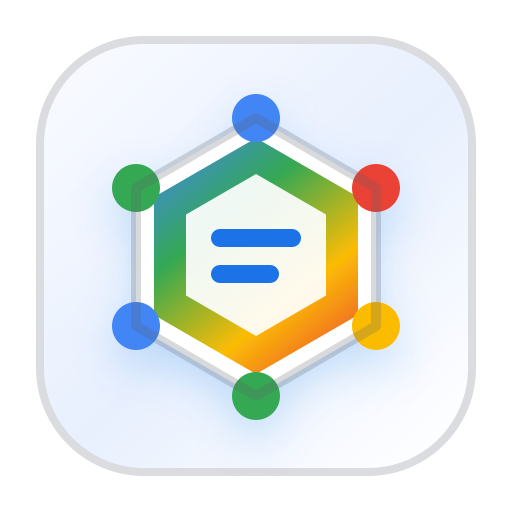

<p align="center">
  
</p>

<h3 align="center">adk-deep-agent</h3>

<p align="center">
  Deep-agent ergonomics on top of native Google ADK primitives.
</p>

<p align="center">
  <a href="https://pypi.org/project/adk-deep-agent/"></a>
  <a href="https://pypi.org/project/adk-deep-agent/"></a>
  <a href="https://github.com/manishdighore/adk-deep-agent/actions/workflows/ci.yml"></a>
  <a href="https://github.com/manishdighore/adk-deep-agent/blob/main/LICENSE"></a>
  <a href="https://github.com/google/adk-python"></a>
</p>

`adk-deep-agent` is a small Python package that creates a standard
`google.adk.apps.App` with deep-agent capabilities pre-wired: a task ledger,
context injection, structured user elicitation, thinking, compaction, skills,
prebuilt subagents, and model-aware on-demand spawned subagents.

The package does not replace ADK. It stays close to ADK's own `App`,
`LlmAgent`, `ToolContext`, `Runner`, `SkillToolset`, and event-stream
primitives.

## Highlights

- **Standard ADK return value**: `create_deep_agent(...)` returns a normal ADK `App`.
- **Built-in task ledger**: a session-backed `todo` tool for planning and progress tracking.
- **Automatic ledger context**: active todos are injected before model calls.
- **Structured elicitation**: optional native ADK `request_input` interruption with UI helpers.
- **Thinking support**: simple wrapper over ADK `BuiltInPlanner`.
- **Native compaction**: optional ADK event compaction with a deep-agent summary prompt.
- **Tool flexibility**: accepts ADK `ToolUnion` values, including functions, `BaseTool`, `BaseToolset`, and MCP toolsets.
- **Skills**: accepts one developer-created ADK `SkillToolset`.
- **Prebuilt subagents**: attaches native ADK `sub_agents`.
- **Model-aware subagents**: exposes a validated model catalog to `spawn_subagent`.
- **On-demand subagents**: runs temporary children through ADK `ToolContext.run_node(...)`.
- **Streaming visibility**: raw ADK runner events include subagent activity; optional projection helpers are included.

## Installation

```bash
pip install adk-deep-agent
```

With uv:

```bash
uv add adk-deep-agent
```

Requirements:

- Python 3.10+
- `google-adk>=2.2.0,<3`

## Quick Start

```python
from adk_deep_agent import create_deep_agent


def search_notes(query: str) -> str:
    """Search local notes."""

    return f"No notes backend configured for: {query}"


app = create_deep_agent(
    name="research_assistant",
    model_client="gemini-3-flash-preview",
    instruction="Investigate accurately and keep progress current.",
    tools=[search_notes],
)
```

Run it with the normal ADK `Runner`:

```python
from google.adk.runners import InMemoryRunner
from google.genai import types

runner = InMemoryRunner(app=app)
session = runner.session_service.create_session_sync(
    app_name=app.name,
    user_id="user",
)

for event in runner.run(
    user_id="user",
    session_id=session.id,
    new_message=types.Content(
        role="user",
        parts=[types.Part.from_text(text="Plan and research the task.")],
    ),
):
    if event.content and event.content.parts:
        for part in event.content.parts:
            if part.text:
                print(part.text)
```

## Factory API

```python
from adk_deep_agent import create_deep_agent

app = create_deep_agent(
    name="assistant",
    model_client="gemini-3-flash-preview",
    instruction="Help the user complete complex tasks.",
    tools=[],
)
```

`model_client` can be a model name string or an ADK `BaseLlm` instance.

## Structured User Elicitation

Set `elicitation=True` to attach ADK's native `request_input` long-running
tool and enable resumability on the returned `App`.

```python
app = create_deep_agent(
    name="interactive_agent",
    model_client="gemini-3-flash-preview",
    instruction="Ask for required decisions before taking irreversible action.",
    elicitation=True,
)
```

The model can request one or more answers with an object JSON schema. When the
runner emits the interruption, project it into a stable UI-facing request:

```python
from adk_deep_agent import (
    create_elicitation_response,
    project_elicitation_event,
)

request = project_elicitation_event(event)
if request is not None:
    # Render request.message and request.response_schema in the client.
    answers = {"environment": "production", "strategy": "canary"}
    response = create_elicitation_response(request, answers)

    async for resumed_event in runner.run_async(
        user_id=user_id,
        session_id=session_id,
        invocation_id=request.invocation_id,
        new_message=response,
    ):
        ...
```

While waiting, ADK makes no additional model call. The response helper creates
the user-role `FunctionResponse` with the original function-call ID so the
same invocation can continue.

## Task Ledger

Every deep agent includes a built-in `todo` tool. The ledger is stored in ADK
session state and reinjected into the model context before future model calls.

The tool supports:

- `todo()` to read the current ledger
- `todo(todos=[...])` to replace the ledger
- `todo(todos=[...], merge=True)` to update by ID and append new items

## Thinking And Compaction

```python
from adk_deep_agent import (
    CompactionConfig,
    ThinkingConfig,
    create_deep_agent,
)

app = create_deep_agent(
    name="configured_agent",
    model_client="gemini-3-flash-preview",
    instruction="Work carefully and keep track of progress.",
    thinking=ThinkingConfig(
        include_thoughts=True,
        thinking_budget=1024,
    ),
    compaction=CompactionConfig(token_threshold=48_000),
)
```

`thinking` maps to ADK `BuiltInPlanner`. `compaction` maps to ADK native event
compaction using a structured summarization prompt.

## Tools And MCP

Pass ordinary callables, ADK `BaseTool` values, or ADK `BaseToolset` values.
MCP toolsets are passed through the same `tools` argument.

```python
from google.adk.tools.mcp_tool.mcp_toolset import McpToolset

app = create_deep_agent(
    name="tool_agent",
    model_client="gemini-3-flash-preview",
    instruction="Use available tools when helpful.",
    tools=[
        my_function_tool,
        my_base_tool,
        McpToolset(...),
    ],
)
```

## Skills

Pass one ADK `SkillToolset` that you construct yourself:

```python
from adk_deep_agent import create_deep_agent
from google.adk.skills import models
from google.adk.tools import skill_toolset

status_skill = models.Skill(
    frontmatter=models.Frontmatter(
        name="status-skill",
        description="Summarize project status.",
    ),
    instructions="Use available project tools and return a concise summary.",
)

project_skills = skill_toolset.SkillToolset(skills=[status_skill])

app = create_deep_agent(
    name="skilled_agent",
    model_client="gemini-3-flash-preview",
    instruction="Use skills when they help.",
    skills=project_skills,
)
```

## Prebuilt Subagents

Prebuilt subagents use native ADK `sub_agents`. Use this when the developer
knows the child roles ahead of time.

```python
from adk_deep_agent import SubAgentSpec, create_deep_agent

app = create_deep_agent(
    name="main_agent",
    model_client="gemini-3-flash-preview",
    instruction="Delegate focused review work when useful.",
    subagents=[
        SubAgentSpec(
            name="reviewer",
            goal="Review delegated work and return risks.",
            mode="single_turn",
        )
    ],
)
```

Modes:

- `single_turn`: focused child work without user clarification
- `task`: ADK task mode with native task completion and resume behavior

## On-Demand Spawned Subagents

Enable `spawn_subagent` when the parent should create temporary specialists at
runtime. Spawned children are still ADK agents and run through
`ToolContext.run_node(...)`.

```python
from adk_deep_agent import ModelSpec, SpawnConfig, create_deep_agent


def inspect_code(path: str) -> str:
    """Inspect code at a path."""

    return f"No code inspection backend configured for: {path}"


app = create_deep_agent(
    name="main_agent",
    model_client="gemini-3-flash-preview",
    instruction="Spawn temporary specialists for bounded tasks.",
    available_models=[
        ModelSpec(
            id="fast",
            model_client="gemini-3-flash-preview",
            description="Fast general-purpose delegated work.",
        ),
        ModelSpec(
            id="strong",
            model_client="gemini-3-pro-preview",
            description="Difficult reasoning and review work.",
            capabilities=["reasoning", "review"],
        ),
    ],
    spawn=SpawnConfig(
        enabled=True,
        tools={"inspect_code": inspect_code},
        allowed_tools=["inspect_code"],
        default_mode="single_turn",
    ),
)
```

The root instruction receives only model IDs and descriptive metadata. The
backend registry retains the actual model clients. `spawn_subagent` accepts an
optional `model` ID, defaults to the root model, and rejects unknown IDs.

Spawned `task` agents are temporary foreground workers. If one needs user
clarification, the tool returns `status="waiting_for_user"` so the parent can
continue explicitly.

## Event Projection

Raw ADK runner events include subagent activity for prebuilt and spawned
children. Use `iter_subagent_events(...)` when you want a lightweight stable
projection for UI code while still retaining each raw ADK event.

```python
from adk_deep_agent import iter_subagent_events

projected = iter_subagent_events(
    raw_events,
    root_agent_name="main_agent",
    child_agent_names=["reviewer"],
)
```

## Examples

Numbered examples live in `examples/sdk`:

- `01_basic_task_ledger.py`
- `02_skills_and_toolsets.py`
- `03_thinking_compaction_plugins.py`
- `04_prebuilt_and_spawned_subagents.py`
- `05_elicitation_and_model_selection.py`

## GitHub Topics

Suggested repository topics:

```text
adk
agent-development-kit
ai-agents
deep-agent
google-adk
llm
multi-agent
subagents
task-delegation
```

## Development

```bash
uv run --extra dev python -m pytest tests/unit
uv build
uv run --extra dev python -m twine check dist/*
```

## Publishing

See [`docs/PUBLISHING.md`](docs/PUBLISHING.md).

## License

MIT
